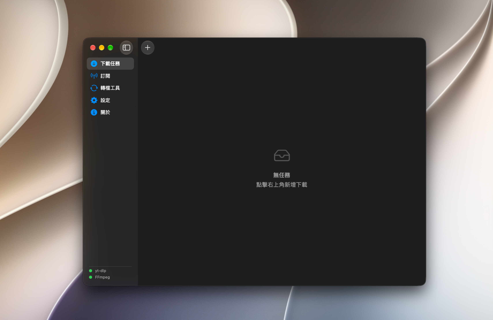
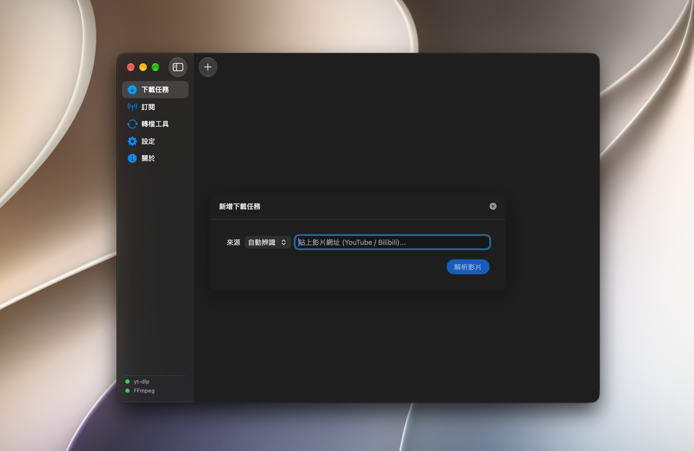
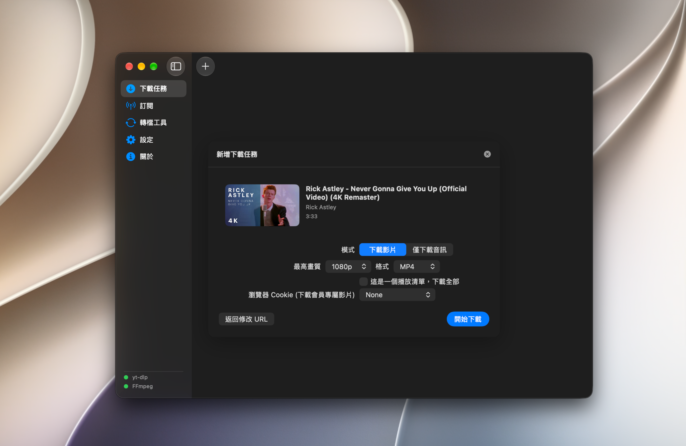
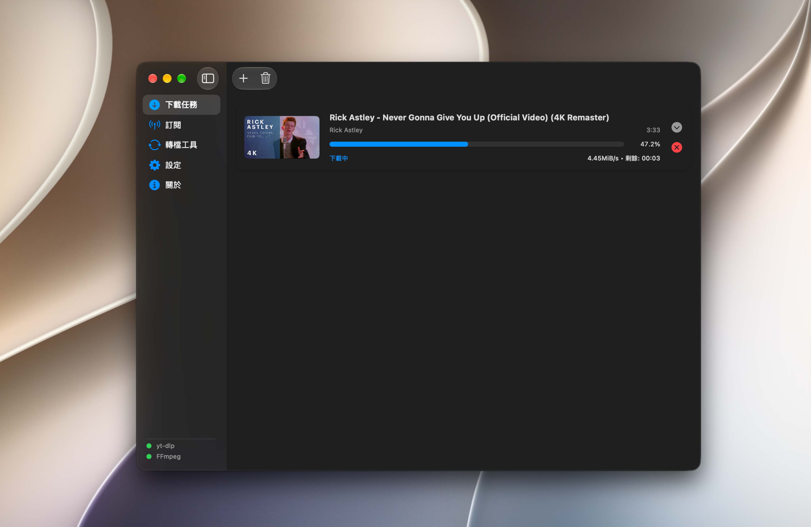
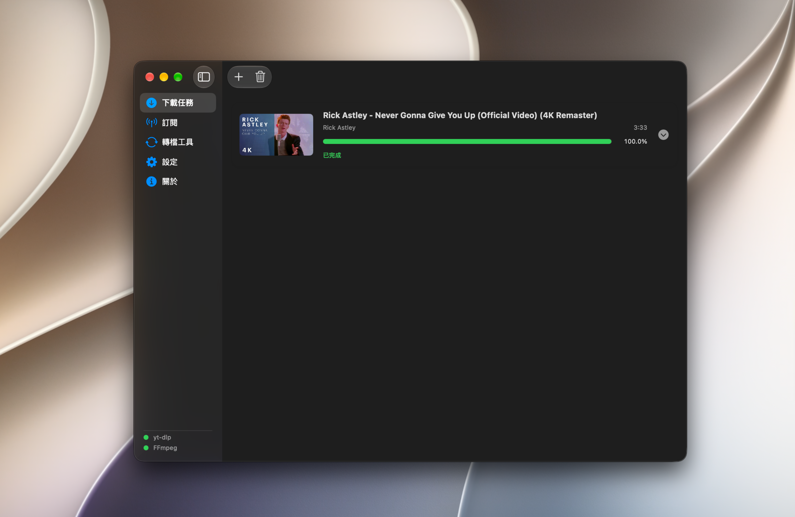
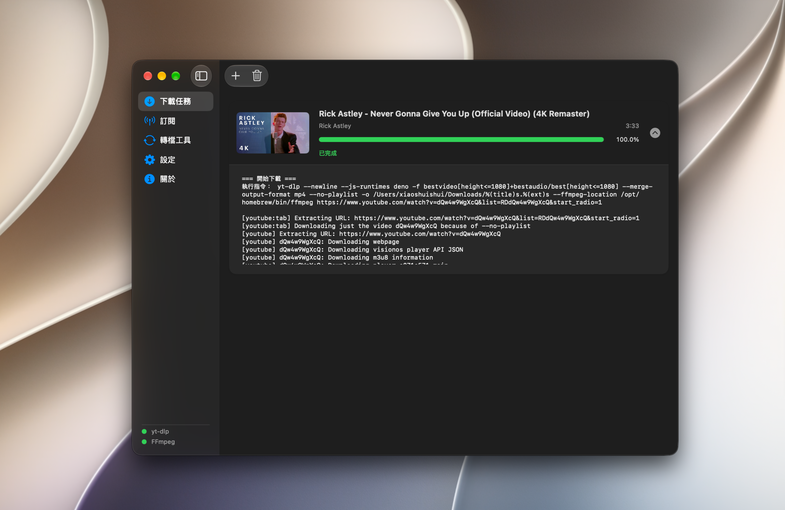

# MediaFetch

**A native macOS video downloader built with SwiftUI.**

MediaFetch is an open-source macOS application designed to make downloading online videos more convenient through a native graphical interface. It provides a graphical alternative to using video downloading tools entirely through the command line.

Built with SwiftUI, MediaFetch combines video downloading and media conversion workflows in an application designed specifically for macOS.
## Screenshots｜應用程式展示

### Main Window｜主畫面



### New Download Task｜新增下載任務



### Select Download Format｜選擇下載格式



### Downloading｜下載中



### Download Completed｜下載完成



### Download Logs｜下載日誌


## Features

- **Native macOS interface** — Built with SwiftUI for a familiar macOS experience.
- **Video downloading** — Supports video downloading workflows through yt-dlp.
- **YouTube and Bilibili support** — Provides source selection and URL detection for supported platforms.
- **Video and audio options** — Configure video quality, output format, and audio-only downloads.
- **Playlist downloads** — Supports downloading entire playlists.
- **Browser cookies** — Supports browser cookie options and importing a `cookies.txt` file for compatible downloads.
- **Download progress** — View task status, progress, speed, remaining time, and logs.
- **Media conversion** — Provides a graphical interface for converting media files through FFmpeg.
- **Configurable tool paths** — Set custom executable paths for yt-dlp and FFmpeg in the settings.
- **Configurable download directory** — Choose where downloaded files are saved.
- **Open source** — The source code is available for users to study, modify, and contribute to.

## Requirements

- A compatible version of macOS.
- [Homebrew](https://brew.sh/) to install the required command-line tools.
- [Xcode](https://developer.apple.com/xcode/) to build the application from source.
- yt-dlp for video downloading.
- FFmpeg for media conversion and related processing.

## Installation

### 1. Install Homebrew

If Homebrew is not already installed, follow the instructions on its official website:

https://brew.sh/

### 2. Install the required tools

Open Terminal and run:

```bash
brew install yt-dlp
brew install ffmpeg
```

These commands install yt-dlp and FFmpeg through Homebrew.

### 3. Download the source code

Clone the repository:

```bash
git clone https://github.com/jyps1090013-stack/MediaFetch.git
```

Enter the project directory:

```bash
cd MediaFetch
```

### 4. Open the Xcode project

Run:

```bash
open MediaFetch.xcodeproj
```

In Xcode, select an appropriate macOS build destination, then build and run the application.

### 5. Configure the tool paths

After launching MediaFetch, open **Settings** and check the configured paths for yt-dlp and FFmpeg.

MediaFetch allows you to edit and save these paths. If either tool is not detected, make sure its configured path points to the correct executable file, then use the dependency status check in Settings.

On Apple Silicon Macs, Homebrew commonly installs these tools under `/opt/homebrew/bin/`. The actual location may differ depending on your installation.

## Building from Source

To build MediaFetch yourself:

1. Install Xcode and the required command-line tools.
2. Clone this repository.
3. Open `MediaFetch.xcodeproj` in Xcode.
4. Select an appropriate macOS build destination.
5. Build and run the application.
6. Check the dependency paths in Settings if either tool is not detected.

Additional setup may be required depending on the project's current configuration.

## License

MediaFetch is licensed under the **GNU General Public License v3.0 (GPL-3.0)**.

You may use, study, modify, and redistribute this software under the terms of the license. Distribution of copies or modified versions must comply with the applicable GPL-3.0 requirements.

See the [LICENSE](LICENSE) file for the full license text.

## Contributing

Contributions, bug reports, and feature suggestions are welcome!

If you find a bug or have an idea for improving MediaFetch, feel free to open an issue or submit a pull request on GitHub.

## Disclaimer

Users are responsible for complying with applicable laws, copyright requirements, and the terms of service of the websites they use. Downloading content may be restricted by copyright or other legal requirements.

---

# MediaFetch（繁體中文）

**一款以 SwiftUI 打造的原生 macOS 影片下載應用程式。**

MediaFetch 是一個開源的 macOS 專案，希望透過簡潔、直覺的圖形介面，讓使用者更方便地操作影片下載工具，而不必完全依賴命令列。

本專案使用 SwiftUI 開發，整合影片下載與媒體轉檔相關工作流程，致力於提供符合 macOS 使用習慣的操作體驗。

## 功能特色

- **原生 macOS 介面** — 使用 SwiftUI 打造，提供符合 macOS 使用習慣的操作體驗。
- **影片下載** — 透過 yt-dlp 處理影片下載。
- **支援 YouTube 與 Bilibili** — 提供來源選擇，並可依影片網址辨識支援的平台。
- **影片與音訊選項** — 可設定影片畫質、輸出格式，以及僅下載音訊。
- **播放清單下載** — 支援下載整個播放清單。
- **瀏覽器 Cookie** — 提供瀏覽器 Cookie 選項，也支援匯入 `cookies.txt` 檔案，以供相容的下載情境使用。
- **下載進度** — 查看任務狀態、下載進度、速度、剩餘時間及詳細日誌。
- **媒體轉檔** — 透過 FFmpeg 提供圖形化的媒體檔案轉檔介面。
- **可自訂工具路徑** — 可在設定頁面修改 yt-dlp 與 FFmpeg 的執行檔路徑。
- **可自訂下載目錄** — 可選擇下載檔案的儲存位置。
- **開源專案** — 公開原始碼，歡迎使用者研究、修改及參與開發。

## 系統需求

- 相容版本的 macOS。
- 用於安裝必要命令列工具的 [Homebrew](https://brew.sh/)。
- 用於從原始碼建置應用程式的 [Xcode](https://developer.apple.com/xcode/)。
- 用於影片下載的 yt-dlp。
- 用於媒體轉檔及相關處理的 FFmpeg。

## 安裝方式

### 1. 安裝 Homebrew

如果你的 Mac 尚未安裝 Homebrew，請前往官方網站並依照指示完成安裝：

https://brew.sh/

Homebrew 是 macOS 常用的套件管理工具，可用來安裝及管理其他命令列工具。

### 2. 安裝必要工具

打開「終端機」（Terminal），執行以下兩條指令：

```bash
brew install yt-dlp
brew install ffmpeg
```

第一條指令會安裝 yt-dlp，第二條指令會安裝 FFmpeg。

### 3. 下載專案原始碼

在終端機中執行：

```bash
git clone https://github.com/jyps1090013-stack/MediaFetch.git
```

下載完成後，進入專案資料夾：

```bash
cd MediaFetch
```

### 4. 使用 Xcode 開啟專案

執行：

```bash
open MediaFetch.xcodeproj
```

接著在 Xcode 中選擇適合的 macOS 建置目標，然後建置並執行應用程式。

### 5. 設定工具路徑

啟動 MediaFetch 後，進入「設定」頁面，確認 yt-dlp 與 FFmpeg 的執行檔路徑。

MediaFetch 允許使用者修改並保存這些路徑。如果程式未能辨識其中一個工具，請確認設定的路徑是否指向正確的可執行檔，再使用設定頁面中的「重新檢查依賴狀態」功能。

在 Apple Silicon Mac 上，Homebrew 通常會將這些工具安裝在 `/opt/homebrew/bin/` 底下。不過，實際位置可能因安裝方式而有所不同。

## 從原始碼建置

如果你想自行編譯 MediaFetch，可以依照以下流程操作：

1. 安裝 Xcode 及必要的命令列工具。
2. 使用 Git 下載專案原始碼。
3. 使用 Xcode 開啟 `MediaFetch.xcodeproj`。
4. 選擇適合的 macOS 建置目標。
5. 建置並執行應用程式。
6. 如果工具未被辨識，請前往設定頁面確認執行檔路徑。

實際建置流程仍可能依照專案目前的設定而需要額外步驟。

## 開源授權

MediaFetch 採用 **GNU General Public License v3.0（GPL-3.0）** 授權。

你可以依照授權條款使用、研究、修改及散布本專案。散布本專案的副本或修改版本時，必須遵守適用的 GPL-3.0 規定。

完整授權內容請參閱專案中的 [LICENSE](LICENSE) 檔案。

## 參與貢獻

歡迎提出功能建議、回報錯誤，或參與專案開發！

如果你發現程式有問題，或有想加入的功能與改進方向，可以前往 GitHub 開啟 Issue，或提交 Pull Request。

## 免責聲明

使用者應自行確認並遵守適用法律、著作權規定，以及所使用網站的服務條款。下載某些內容可能受到著作權或其他法律規範限制。

---

## 專案連結

- [GitHub Repository — MediaFetch](https://github.com/jyps1090013-stack/MediaFetch)
- [GNU GPL-3.0 License](LICENSE)
